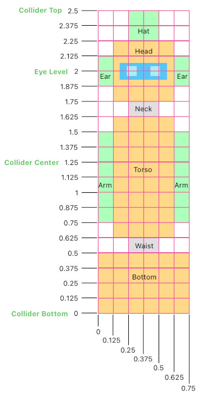
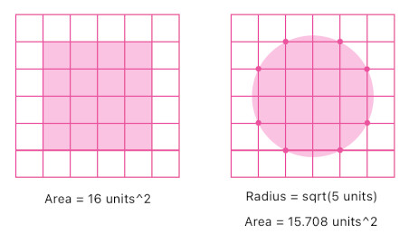
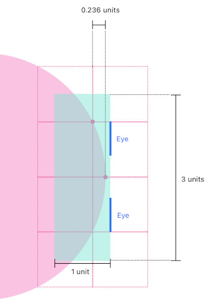

# Player Customization System

Reference: @src/shared/graphics/mesh/composition/types/compositionCodec/playerCompositionCodec.ts , @src/shared/graphics/mesh/composition/types/compositionBuilder/playerCompositionBuilder.ts , @src/client/object/types/gameObject/playerGameObject.ts , @src/shared/object/types/objectTypeConfig/npcObjectTypeConfig.ts , @src/client/object/types/gameObject/npcGameObject.ts , @src/client/ui/components/panel/customizePlayerPanel.tsx

The character's appearance is an `InstancedMeshComposition` (see [instanced_mesh_composition.md](../graphics/instanced_mesh_composition.md)). Its parameters are encoded as a compact base-94 string that is stored in the user's `playerMetadata`. The customization panel is visible while the user's own character is selected in edit mode.

- Each part takes one of a few shapes, which the panel numbers; agents choose by the same numbers (see [agents.md](../networking/agents.md#the-body)).
- A color is stored as an index into a palette: the parts' vivid "tin toy" hues, or the eyes' own. **Palette entries are only ever appended**, because reordering them would change every saved character. A look stored without an eye color reads back the eyes' first (green).
- The face is drawn with the unlit material, so its colors, the eyes' palette included, are kept dim enough to read as paint rather than as a light.

## Design standards
The body is built from primitives placed on a discrete grid. Offsets are counted in grid cells rather than raw coordinates.

- **Circular shapes**: a cylinder in an N×N space is sized to fully cover the middle two cells on each side, and no larger. Its area then roughly matches the square's, and neighbors attach without gaps.

  
- **Eyes on a cylinder**: the head's side is padded with a box so the flat eyes have a flat surface.

  
- **Fit**: every part stays inside the player's collider, and so below its top, where speech bubbles start. Parts of different slots sink into each other no deeper than a round part sticks out, and no two faces lie flush facing the same way (they flicker). The integration tests hold every shape to these.
- **Left and right**: the left ear and arm are mirror images of the right ones, so a design may differ front to back.
- **Nothing face-like**: a head adds no nose, mouth or brow, which would read as an expression.
- **Wheels**: external ones turn outside the body, internal ones between fork legs that hold their axles from both sides. Either kind spans about the bottom's full width, and a slab over internal ones spans just the fork legs under it.

## NPCs
An NPC is a character no person plays, with a player's body (`NpcObjectTypeConfig`). It is an attached object that stands on a floor (see [object_attachment.md](object_attachment.md)), is kept with the room, and is laid and edited by admins only (see [admin.md](../gameplay/admin.md)).
- Its look is stored on the object in the same encoded form and edited in the same panel. One that stores none is given a look drawn from its own id, the same for everyone.
- Its name is its `Label` metadata, kept short, and comes before whatever it says, with "(AI)" after it while it is played as a helper (`NpcGameObject`). The way it faces is its `QuarterTurns`, unless it is a helper the server turns (`Facing`); its body turns toward either over a moment.
- It is a helper, an AI guide (see [agents.md](../networking/agents.md#helpers)), played by the server in a multiplayer room and by the browser in a single-player room that plays NPCs, as its `BehaviorPrefs` have it (its personality, how far from where it was put it wanders, whether it climbs, whether it goes home between wanders, how long it idles between them), which its tools set in a panel of their own beside its looks. An Idle one is played by nobody: it stands still, and what it says and does is up to a single-player room's steps (see [single_player_mode.md](../networking/single_player_mode.md#npcs)).

Reference designs: `PlayerHat` type 1 ([figure](figures/player_customization_4.jpg)); `PlayerBottom` components ([figure](figures/player_customization_5.jpg)) and types 0–2 ([figure](figures/player_customization_6.jpg)).
