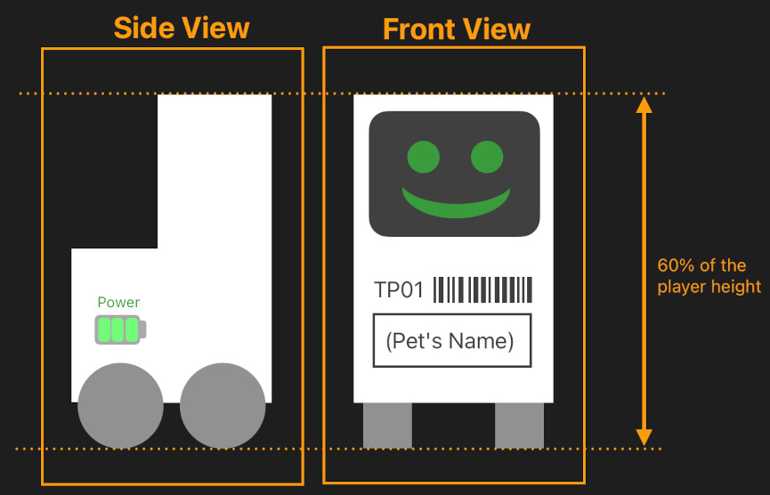
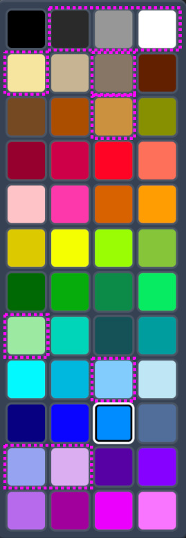

# Pet System

Last Updated: 2026-11-23

## Overview

Let's allow users to buy their own pets. Each pet should cost $30, and it should be purchasable via one of the "add" buttons in @robot-rooms/src/client/ui/components/hud/selection/voxelQuadPlacementOptions.tsx.

## Core Mechanics

- Each pet should be an object (with a rigidbody component) whose transform will be updated by the client side (just like the user's own PlayerGameObject). By "client side", I mean the client runtime of the user who owns the pet. When hit by a fan's wind or a cannon ball (see @robot-rooms/docs/gameplay/cannon.md), the pet object should be pushed away. (Note: There should also be special pets called "server-side pets"; see the "Pet Initialization" section near the end of this document for more details.)
- When the user enters the room (i.e. The user's PlayerGameObject spawns), every one of the pets he owns should sequentially enter the room one after the other, in a non-colliding manner (e.g. If the user owns 3 pets called A,B,C and his PlayerGameObject enters the room, the client app should wait for the door's front spot to be cleared out until it spawns pet A there, and then wait for the door's front spot to be cleared out until it spawns pet B there, and then wait for the door's front spot to be cleared out until it spawns pet C there).
- When the user exits the room (either by disconnecting from the server or by entering another room), every one of his pets should immediately disappear with a holographic vanishing effect (like that of Star Trek).
- A cannon does not willingly aim & fire a ball at a pet.
- Let's record all the state information of the user's pets as part of the DBUser's "playerMetadata" field (Take extra precautions to verify that "playerMetadata" will never get erased accidentally during race conditions & edge cases, such as the user refreshing the browser tab, disconnecting at unexpected points in time, etc).
- Similar to NPCs, pets should wander/idle by default and occasionally engage in random activities such as smalltalks, remarks, and so on. Unlike NPC, however, their actions should be updated/communicated by their owner's client application (not by the server). Since the number of pets could be quite many, though, sending only the waypoints & interpolation rates across the network (instead of every tiny change in each pet's ObjectTransform) seems to be a better choice for performance.
- Only the pet's owner should be able to remove the pet. When removing the pet, however, the owner must be paid the 1/3 of the pet's price if the pet's current health level is greater than or equal to 0% but less than 1/3 of its full value, 2/3 of the pet's price if the pet's current health level is greater than or equal to 1/3 but less than 2/3 of its full value, or 100% of the pet's price if the pet's current health level is greater than or equal to 2/3 of its full value. The amount of money (dollars) which will be paid when the pet gets removed (sold) should be displayed as "+{dollarIcon}{sellPrice}" beneath the pet's remove-button. The removal-confirmation window should also mention: "Do you want to sell your pet with the price of ${sellPrice}? It will be gone forever!" before the user confirms it.
- Only the pet's owner should be able to select the pet in the edit-mode. Unlike NPCs, however, selecting a pet shouldn't make it snap back to its initial position; the selection's pivot/gizmo should follow the pet's current position in real time. When the pet is selected, a "remove pet" button should appear (and nothing else).

## Appearance

### Mesh
- A pet should consist of InstancedTin mesh instances (just like players and NPCs), and the surfaces of these mesh instances must be far less rusty when the pet's health is near its max value. As the health drops, the rustier the surface should get (This means we should make sure that InstancedTin's shader has its rustiness parameters set to be customizable on a per-instance basis). The color of the main body mesh instances should be very light gray (e.g. bone white), like that of old-school desktop computers such as the original Apple Macintosh.

### Identity Indicator
- Beneath the pet's model name ("TP01") and the bar code which are fixed and do not vary across different pet instances, there will be a rectangle which is surrounded by rectangular borders. Inside this rectangle, the pet's own name will be printed in pixelated font (like that of the cannon's ball-count display).

### Battery Indicator
- The side of the pet's body should have a small battery indicator which consists of 3 levels (0-33% should be shown as level-1, 33%-66% should be shown as level-2, and 66%-100% should be shown as level-3). level-1 will be displayed as a single red rectangle, level-2 will be displayed as two orange rectangles, and level-3 will be displayed as three green rectangles.

### Facial Expressions
- The upper portion of the pet's front side should be a CRT monitor with a simple facial expression being displayed on it.
- I think facial expressions could be made of procedural textures (because they are based upon simple geometric shapes), yet make sure to batch them as efficiently as possible (so as to minimize the number of draw calls well as the overall GPU budget).
- When the pet is pushed by a strong force (such as a cannon ball's explosion or a fan's stream of wind) or is attaked by another pet suddenly and unexpectedly (i.e. the attack was first-time, after a period of peace), its face should show a sign of surprise by widening the eyes and briefly changing the shape of the mouth to the "O" shape.
- When the pet reacts to the user's room-editing activity, it should smile (with an upward-curved mouth) toward the user.
- When the pet is either doing nothing or is engaged in an object-remark, smalltalk, or other ordinary activity, its facial expression should be either neutral (horizontal line mouth), happy (upward-curved mouth), or sad (downward-curved mouth) depending on the estimated mood of the activity.
- When the pet is sleeping, its eyes must be closed, and its mouth should be neutral (horizontal line).
- When the pet's fatigue is too high, its eyes must frequently oscillate between the open state and closed state to show how sleepy it is.
- When the pet's health is too low, its face should express sadness much more frequently.
- When the pet is angry, its eyes should be tilted inward (in the "v" shaped pattern) to express a sense of anger, and its mouth should be curved downward to express a sense of displeasure.

### Additional Concerns
- p.s. Both a player's eyes and pet's face, as well as the battery display, should be rendered using the InstancedEmissive material (on flat quad surfaces). Just like a cannon's ball-count display, however, their degrees of brightness should fade away as the camera gets farther and farther away from them.

## State Variables

- Each pet should have its own state variables which may change over time (while the user is connected - i.e. active inside the room).

### Health
- Drops very gradually as time passes by (which means it also works as "remaining lifespan"). The total amount of time needed to drop the health from its max to 0 should be 24 hours. If the health is estimated to hit 0 within 3 hours of the user's in-game time, the pet should frequently display the "I'm dying. Give me {wrench icon}" message in its SpeechBubble (in bright red font) along with a sad emoji.
- While the user is not connected to the game (i.e. while the user's PlayerGameObject is not active in a room), the health shouldn't drop. That is, the clock which ticks down the health should freeze while the user is away.
- When the health is sufficiently high, the pet looks intact and fresh (very small rust). When the health is low, the pet looks rusty (like a piece of damaged/rusty toy robot). When the health is somewhere in between, the pet looks neither too clean nor too rusty (i.e. somewhere in between - an interpolated appearance).
- While the pet is being attacked by another pet (which may last for about 10 seconds on average), its health should drop 180 times faster than usual. That is, a single second of attack should deal a damage that is approximately worth 3 minutes of lifespan.
- Whenever the pet is hit by a cannon ball's explosion, its health should drop by an amount which would've normally be dropped by waiting for 3 hours.
- When the health drops down to 0, the pet dies and turns into a piece of scrap (just like CannonGameObject), which is a static object (i.e. persistent object which doesn't disappear when the user disconnects) that can only be moved via the edit-mode and bounces off cannon balls. Unlike a cannon's scrap, however, a pet's scrap should only change its color (and not be deformed in shape).
- When the pet dies and turns into a piece of scrap, it should be removed from the user's list of owned pets and thus cease to enter the room along with the user's player character.

### Energy
- Drops gradually as time passes by. A fully charged pet should last for 3 hours in total until it gets fully drained of its power.
- While the user is not connected to the game (i.e. while the user's PlayerGameObject is not active in a room), the energy shouldn't drop. That is, the clock which ticks down the energy should freeze while the user is away.
- When the energy hits 0, the pet's facial expression should keep flickering at regular intervals and its battery indicator should show up as empty, and its SpeechBubble should show the message "I'm out of battery. Give me {batterh icon}" in medium gray font. Also, the pet should no longer be able to engage in activities (such as smalltalks, remarks, etc), although it should still (very slowly) walk toward the nearest battery for a recharge and its rigidbody should still allow it to be pushed by mechanical forces such as that of a fan, cannon ball explosion, collision with other rigidbodies, etc.

### Anger
- Increments when the pet is either attacked or is close to another pet which it hates (due to personality differences, due to random chances, or else), or when it is exposed to an anger-inducing "aggro" field.
- Aroused anger quickly dies down as time passes by. For a relatively more aggressive pet, however, the anger drops more slowly and gets aroused more easily.
- A pet's anger level should drop faster when it engages in a smalltalk, remark, or other activity that is classified as "pleasant" (happiness-inducing).
- While the user is not connected to the game (i.e. while the user's PlayerGameObject is not active in a room), the anger shouldn't drop. That is, the clock which ticks down the anger should freeze while the user is away.

### Horror
- Increments when it is exposed to a horror-inducing "aggro" field.
- Aroused horror dies down (at a moderate rate) as time passes by. If the horror level gets too high, though, the pet will start its "panic" action. During this panic action, its horror level should be dropping much more rapidly. Note that the horror-level threshold which triggers a panic should be considerably higher than the horror-level threshold which stops the panic (so as to prevent the pet from starting its panic and then ending it almost immediately after).
- While the user is not connected to the game (i.e. while the user's PlayerGameObject is not active in a room), the horror shouldn't drop. That is, the clock which ticks down the horror should freeze while the user is away.

### Fatigue
- Decrements when the pet sleeps, and increments when the pet is not sleeping.
- While the user is not connected to the game (i.e. while the user's PlayerGameObject is not active in a room), the fatigue shouldn't increment. That is, the clock which ticks up the fatigue should freeze while the user is away.

## Consumable Items

- Pets should be able to approach certain items and eat (consume) them.

### Battery
- The user should be able to place a battey on the groud, which should be a single quad with the image of a battery (Don't make it too cartoony). When a battery is placed, nearby pets whose energy levels are less than 66% (i.e. battery indicator shows level-1 or level-2 but not level-3) will slowly move toward it and whoever touches it first will eat it. The act of eating should exhibit its own VFX and SFX.
- Eating a battery makes the pet's energy level immediately go back to its max value (i.e. fully charge the pet).

### Wrench (Double Open-Ended)
- The user should be able to place a wrench on the groud, which should be a single quad with the image of a wrench (Don't make it too cartoony). When a wrench is placed, nearby pets whose health levels are less than the minimum percentage required to render the mesh in its cleanest condition (which should be about 90%) will slowly move toward it and whoever touches it first will eat it. The act of eating should exhibit its own VFX and SFX.
- Eating a wrench makes the pet's health level go up by 1/3 of its full health range.

## Personalities

- Each pet must have its own personality traits.

### Dependence
- Options: low, medium, high
- Manually configured by the user (inside the initial customization popup, via a discrete slider UI).
- Controls the pet's tendency to stay in proximity to the owner and react to his actions (i.e. emotionally attached to the owner).
- A high-dependence pet will sometimes even come very close to the user (i.e. the owner with a relatively high probability or a stranger with a relatively low probability) and keep mildly bumping against his player hitbox, as though it is trying to hug the user.

### Sociability
- Options: low, medium, high
- Manually configured by the user (inside the initial customization popup, via a discrete slider UI).
- Controls the pet's tendency to smalltalk with other pets.
- A high-sociability pet will sometimes even jump with excitement while being engaged in an interesting interaction with another pet.
- A low-sociability pet spends much more time engaging in remarks (monologues) than smalltalks. Think of low-sociability as synonymous with "introversion".

### Aggressiveness
- Options: low, medium, high
- Manually configured by the user (inside the initial customization popup, via a discrete slider UI).
- Controls the pet's tendency to fight with other pets and/or attack them.
- Controls the pet's tendency to respond to an attack with a counter-attack rather than with a flee.
- Controls the pet's tendency to increment its anger level when it is exposed to an "aggro" field.

### Bravery
- Options: low, medium, high
- Manually configured by the user (inside the initial customization popup, via a discrete slider UI).
- Controls the pet's tendency to increment its horror level when it is exposed to an "aggro" field.

### Zodiac Sign
- Options: All Zodiac Signs (encoded as integers for efficiency)
- There are special love/hate relations among these Zodiac signs. A pet has a tendency to either love or hate another pet based on both their Zodiac Signs and other subsidiary personality traits (e.g. bravery, aggressiveness, sociability, dependence). Each pair of Zodiac Signs has its own love, hate, or neutral relation. Refer to The Sims 1 as an example.
- The Zodiac Sign of a pet is hidden (invisible) and is randomly determined. That is, it cannot be assigned by the user.

## Actions

- Pets will need to be able to perform certain actions either randomly or due to a cause.
- Different types of actions must have their own priority levels. For example, "panic" should be of the top priority, "attack" should be of next to the top priority, etc.

### Idle
- Idle refers to "no ongoing action in particular". In this case, the pet should stay still (unless its body is pushed by some mechanical force).

### Wander
- When there is nothing particular to do, the pet will randomly just wander around (just like an NPC, but controlled by the owner's client runtime).

### Smalltalk
- Random chat with other pets (in a manner similar to the NPC smalltalk)

### Object-Remark
- Random remark on nearby objects (in a manner similar to the NPC remark on nearby objects)

### Edit-Remark
- Random remarks on the user's edit-mode actions (such as contructing blocks, adding/moving objects, etc).

### Attack
- Random attack of a pet that is directed toward another pet it hates; the resulting attacks damage the attacked pet by reducing its health. An attack is triggered usually when the anger level is high and the other pet's personality difference causes hatred.
- When an attack is triggered, it temporarily generates an "aggro" field which makes other nearby pets horrified for a moment and flee (or get angry and join the fight if they are aggressive and fond of fighting). By the way, an "aggro" field should probably be activated also when a fan pushes a rigidbody with a strong gust of wind or a cannon ball explodes; they just need to arouse anger/horror in different ratios (perhaps much less anger and much more horror).
- While attacking, the pet should make quick/brief succession of charges toward the target of its attack (like a bull charging with its pair of horns) in order to make it look obvious that it is attacking. Also, each time it charges and hits the target, a spark VFX and SFX should play so as to make the effect more spectacular.

### Panic
- A horrified pet should panic for a moment and run around (with horrified facial expressions such as an "X" in place of both eyes + the mouth in "O" shape). This act of panic should rapidly drain the horror level (much more than usual). When the horror level drops below some threshold, the panic should end.
- While panicking, the pet should also rapidly bounce (jump) up and down to show how physically aroused it is.

### Sleep
- Sleeping (with a sleeping particle effect such as the "zzz") to reduce the fatigue. Sleep ends when the fatigue drops down to zero, and begins when there is no pending action and the fatigue is near its maximum value.

## UI

- Let's make the "add" buttons in @robot-rooms/src/client/ui/components/hud/selection/voxelQuadPlacementOptions.tsx much more compact by grouping them into submenus.
- Make sure to set the colors/shapes of the adjacent menu button icons to be sufficiently different from one another, so as to make them easily distinguishable by their looks.
- When the user clicks a top-menu button and it happens to have its own sub-menu buttons, the top-menu button should be activated (in same manner as the toggle button called "userIdentityButton" in @robot-rooms/src/client/ui/components/hud/topBar/topBarMenu.tsx) a column of sub-menus should show up right above it. When the user clicks the activated top-menu button, the column of sub-menus should disappear and the button should be deactivated. When the user clicks one of the sub-menu buttons while the column is active, the corresponding callback function of that sub-menu button should be executed and the column should disappear.
- Activating another top-menu button should automatically deactivate the currently active sub-menu.

### Proposed new menu hierarchy for VoxelQuadPlacementOptions:
- "Remove voxel block" button
- "Add voxel block" button
- "Decorative objects" button
    - "Add canvas" button
    - "Add prop" button
    - "Add lamp" button
    - "Add label" button
    - "Add mirror" button
- "Mechanical toy objects" button
    - "Add fan" button
    - "Add cannon" button
- "Social entity objects" button
    - "Add npc" button
    - "Add pet" button
    - "Add battery" button
    - "Add wrench" button
- "Add door" button

### Pet Initialization
- When the user clicks the "Add pet" button, the system should first bring up a popup form (with the title "Generate Pet" and two button at the bottom called "Generate"/"Cancel") which lets the user fill out the following pieces of information for the new pet:
    - The pet's own name (which will be printed on its front side), beneath the model name and the bar code. Preceding/trailing white spaces must automatically be trimmed, and the total number of characters should be limited to 16. Foreign characters should be allowed.
    - The pet's personality traits (except the Zodiac sign).
    - (Admin user only): A boolean option (checkbox) which lets the pet reside on the server side and not follow the owner when the owner disconnects or moves to another room. Such a special type of pet will be called a "server-side pet". A server-side pet, unlike regular pets who must be updated by their owner's client runtime and are bound to disappear when the owner disconnects from the server, must be directly managed by the server as well as persist (keep existing) even when the admin owner disconnects. Also, a server-side pet must stay within the same room in which it initially spawned instead of following its owner when the owner moves to another room. Overall, a server-side pet should be managed in approximately the same way as that of an NPC (i.e. helper agent).
- Once the user fills out this initialization form and and hits the "Generate" button, the form will go away and the corresponding pet will be purchased (via a transaction, like that of a cannon purchase) and be spawned right above the currently selected voxel quad. From then on, the pet must stay owned by the user until it dies due to its health dropping to 0.

# Amendment 1

- Instead of letting the user place battery/wrench items on the floor, let's just make the user "inject" either a battery or wrench directly into the currently selected pet (in edit-mode) by clicking a button in "PetEditOptions". If the user is the pet's owner, PetEditOptions should show 3 buttons: "Remove Pet", "Inject Battery" (Charge), "Inject Wrench" (Repair). If the user is NOT the pet's owner, PetEditOptions should show 2 buttons: "Inject Battery" (Charge), "Inject Wrench" (Repair). Injecting a battery should cost $3, and injecting a wrench should cost $5. The sell price indicator in the "Remove Pet" button, for visual distinction, should be colored yellow instead of green. Anyways, since batteries and wrenches will no longer be items that can be placed on the ground, any of their associated logic should be gone. But the VFX/SFX for battery/wrench injection should be retained.
- Let's also allow the user to "select" a pet in play-mode (which will temporarily relace the chat input UI with PetEditOptions UI). When selected in play-mode, the pet should exhibit a selection gizmo around its mesh but the camera shouldn't follow it (because the camera isn't in the orbit-mode when GameMode is set to play-mode). If the selection gizmo is out of the camera's field of view in play-mode, therefore, the selection should be deactivated. Also, when the user clicks somewhere else in world space, the selection should be deactivated as well. The purpose of play-mode pet selection is to let the user inject battery/wrench into the pet without necessarily entering the edit mode.
- In both play-mode and edit-mode, a pet's selection gizmo should be a cuboid wireframe (which fully encapsulates the pet's mesh) instead of a square wireframe.
- Only either the owner of the pet or an `Admin`-type user should be able to remove the scrap of a pet.
- Let's just use the regular font for the pet's name instead of a pixelated font (This will simplify the font styling problem - especially for foreign language characters).
- The lower portion of the back side of the pet's mesh (i.e. hip) should have the TP01, bar code, and the pet's name printed out as well, just like the lower portion of the pet's front side.
- Since a guest user is going to lose all of his pets as soon as he loses his browser cookie (token), a pet-equivalent of the dollar quantity display UI's "Sign-In to save your progress" FTUE will be necessary. Let's display such an FTUE message (with a "Sign-In" link button) in the form of the pet's SpeechBubble and let it stay for at least 10 seconds whenever the user adds a new pet (during which the pet will be forced to idle), if the user is of type `Guest`.
- A pet should be able to climb up a wall that is 2 voxel blocks high (unlike a player or NPC who can only climb up a wall that is at most 1 voxel block high). This should be taken into account in each pet's pathfinding logic as well.
- A pet should come to the user when he mentions its name inside his sent chat message (case-insensitive). Also, a pet should randomly talk to users (If the user is the owner, the probability of such a random talk should be higher than when the user is a non-owner. Also, if a pet has a high-dependency personality, the probability of such a random talk should be higher than when the pet has a relatively independent personality).
- A pet's remark on user activities should occur to non-owner users as well (although the pet should still have a significantly higher chance to remark on its owner's activities than those of other users).
- A high-dependency pet should tend to wander in places that are relatively close to its owner, rather than plain random spots.
- Inside the pet initialization popup form UI, the `Admin`-type user should also NOT have the "server-side pet" option checkbox; from now on, we will make all admin-issued pets server-side by nature (i.e. they persist within the room in which they spawned, regardless of whether their owner admin is online or not). Instead, let us let the `Admin`-type user choose among 3 options (via a simple stepper input element): 25% fixed-health, 50% fixed-health, and 100% fixed-health. Option 1 will make the pet's health be fixed at 25% and never change, option 2 will make the pet's health be fixed at 50% and never change, and option 3 will make the pet's health be fixed at 100% and never change. Since an admin-issued pet's health is always fixed, the "Inject Wrench" button should never appear in its selection.
- A pet should often be able to randomly talk to (remark on) nearby users (especially its owner - with higher probability) even if they are not doing anything in edit-mode.

# Amendment 2

- I once saw a pet displaying an angry facial expression while sleeping. Pets should always have their eyes closed (i.e. be a pair of horizontal lines) while sleeping.
- It looks like pets never wander upstairs when the owner is on the lower floor, and never wander downstairs when the owner is on the upper floor. Pets should always be able to wander up/down through staircases.
- There should be much more variety in pet speech. The phrases which show up in each pet's SpeechBubble feel a bit too repetitive. Consider apply some procedural algorithms to make random variations in predefined phrases as well, for further diversity in expression, besides having a larger set of predefined phrases.
- When a pet speaks (by showing some phrase in its SpeechBubble), the speech should last a lot longer (at least 3 times the original duration). Right now, each speech disappears a bit too quickly. An existing speech should perhaps last as long as a user's chat message, unless it gets replaced by the next line of speech before it hits its expiration time.
- Let's not put "(AI)" next to the pet's name in its SpeechBubble.
- Each user (except admin) should be able to own only up to 16 pets (for performance reasons).
- Lets make the battery-injection cost $5 and wrench-injection cost $10. Also, let's make each pet's health and energy drain twice as quickly as before (both when time elapses and when the pet is being damaged due to an explosion or attack).
- A cannon should be able to fire a ball at a player even when a pet is blocking the line of sight between the cannon and the player.
- Let's add one more personality trait to each pet (which should also be customizable via the initialization popup form): "curiosity". This trait drives the pet's tendency to venture (wnader) into far and/or unfamiliar places such as narrow corners/pits, high places, edges, fans, etc.
- The pet's mesh doesn't look rusty enough when its health is 50%. At least about 40% of the surface area of the pet's mesh should be covered with rust when its health is 50%, yet right now only about 10% (or even less) of the area seems to be covered with rust.
- When the user is editing a part of the room, the pets should express their remarks right in front of the part of the room that is being edited (e.g. blocks/objects which just got added or removed, object which just got moved or rotated, and so on), instead of the user who is editing it. This is because the user's camera is looking at the part of the room that is being edited when the user is in the edit mode.
- A pet's facial expression flips back to its previous state right after its current action (e.g. remark, smalltalk) is over. This feels weird. The pet's on-action facial expression should last longer (at least for 6-8 seconds) after the action is over, unless it suddenly gets interrupted by an event which is supposed to change the facial expression in some other way.
- Aggro fields should be wider in range, so that pets that are moderately nearby (not only those that are extremely nearby) will be affected by it as well.
- When a pet, which is selected in play-mode, is selected again, its selection should be deactivated. Also, when the play-mode pet selection is deactivated (either by a click or by the pet moving outside of the camera's field of view), the first-person camera's pitch angle should go back to its default value.
- The "I'm dying. Give be {wrench}" alert message's time threshold should be reduced down to 60 minutes before the estimated moment of death.
- When two pets are fighting with each other, their bodies overlap too much. This side-effect should be alleviated if possible.
- Pet conversations, as well as remarks, should occasionally (but not so often) have some speech lines which include link-buttons to some of my recent thingspool.net website library posts or their list pages (as a form of recommendation/promotion), just like NPC conversations do. Note that pet conversations, in general, should be able to be updated as the game's contents and the website's contents (such as library pages) get updated. This means that we should rename the "helper-instructions" Claude skill to "gameplay-ai" and expand its scope to include the updating of the behavioral instructions of not only NPC characters, but also pet characters. In addition, the "writing-push" Claude skill should also (as part of its jobs) automatically invoke the "gameplay-ai" Claude skill in order to keep the behavioral instructions of both NPCs and pets in sync with the game/website's latest contents.
- The background color of the bordered box, which contains the pet's name, should be a bit different from the pet's main body color (perhaps a moderately light and low-saturation yellow?). Also, this bordered box should not get rusty at all (because the rust makes the name hard to read).
- Besides 3 fixed health levels, the admin should also be able to set 3 fixed energy levels (level-1, level-2, level-3) for the pet. An admin-owned pet should always have BOTH its health and energy values fixed, and non-admin users should not be able to select an admin-owned pet.
- When the pet says "I'm out of battery. Give me {batteryIcon}" or "I'm dying. Give me {wrenchIcon}", clicking this pet's SpeechBubble should automatically select the pet (regardless of whether the user is in play mode or edit mode), so as to bring up the battery/wrench injection buttens that the user can see and click.

# Amendment 3

- Sometimes, I can see a particle effect (such as a pet's sleeping effect) linger in the midst of thin air intermittently for a while, especially after switching the current browser tab from the app's tab to another tab, waiting for a while, and then switching back to the app's tab. This linger problem should be mitigated.
- When the user opens up a page link as an iframe (inside the robot-rooms app's own browser tab) instead of in another browser tab, the user's SpeechBubble display his status as "Reading..." instead of "Offline...".
- Inside the iframe (which has opened up because the user clicked a page link in a SpeechBubble), any link element (html) which leads to the robot-rooms app (https://app.thingspool.net) should simply close the iframe instead of reloading the app (`mypage.ejs`) in the browser tab. Also, if the user clicks a link which leads to an external site (such as a game link which leads to the game hosted on GameArter), an in-app confirmation popup should show up and ask the user whether he really wants to visit this external page. If he confirms, then the confirmation will go away and the external page will open up on a new browser tab (regardless of whether the link itself is configured to open up the page on the same tab or on a different tab).
- Are you sure that the pets are responding to user messages using the Claude Haiku API? Inside the local dev server environment, the spinner doesn't even appear on the pet's SpeechBubble before it responds to the user's message (It needs to appear, like when an NPC is preparing its response to the user's message), and it doesn't seem to be processing the user's message via the API (The content of its response seems to merely avoid making any logical answer to the user's message).
- Let's make the NPC/pet conversation patterns (e.g. smalltalks, remarks) a lot more diverse and richer in content, so as to further reduce the sense of repetitiveness which may arise when the user plays the game for a long time. Of course, this may signiticantly increase the total size of the app bundle (either the client bundle, server bundle, or both). If the collection of the conversational patterns add up to the client bundle (which will slow down the user's initial app-loading routine), let's load these client-side conversational patterns as a separate file (e.g. JSON or its compressed binary) through a separate HTTP requesst after the client app loads. This way, we will manage to keep the initial loading time of the client app fairly low, while making sure that the conversations are as diverse as possible.
- If the pet is close to dying (due to its health being low) so that it is frequently asking the user to feed it a wrench, it should come over to the vicinity of the user's location (or the current camera pivot, if the user is in the edit mode) and stay close to it, so that the user can notice its presence and inject a wrench to it promptly.
- The user should be able to select/toggle/remove CannonGameObjects during the play mode (not only during the edit mode). The deactivation & camera pitch angle reset logic of the play-mode cannon selection should follow that of the play-mode pet selection.
- Let's increase the price of a pet to $50.
- Inside the pet generation (initialization) form, let's add a color customization option which will determine the overall body color of the pet (but not the face, name plate, or the wheels). For this, let's have yet another type of color palette which only consists of the colors surrounded by the dotted magenta rectangles in: . The default color should be the white one. Note that, in case of the darkest gray color choice, the "AI26" and the bar code will be rendered in white instead of black. For all other color choices, the "AI26" and the bar code should be rendered the same way as before.
- Only either an `Admin`-type user or the owner of the pet should be able to remove the pet's scrap. This means that, when a pet dies and turns into scrap, we need to record the userID of that pet's owner as part of the scrap's ObjectMetadata. Then, whenever a non-owner who is not an admin happens to select this scrap, the "remove" button must not appear in the selection's PetEditOptions (And of course, the server side itself should prohibit such a user from removing the scrap as well).